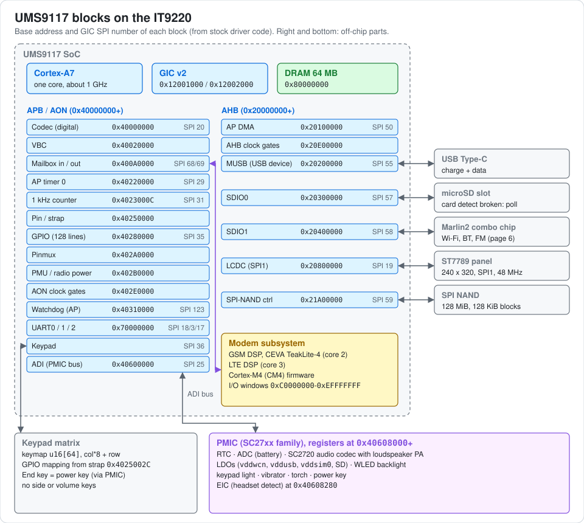
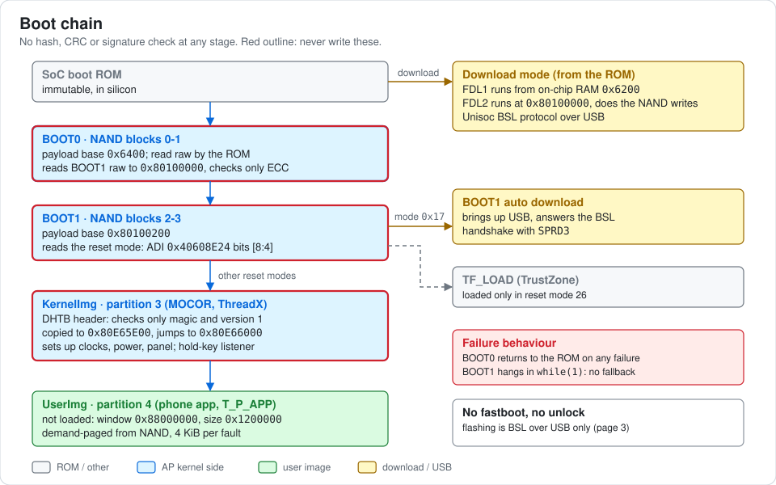
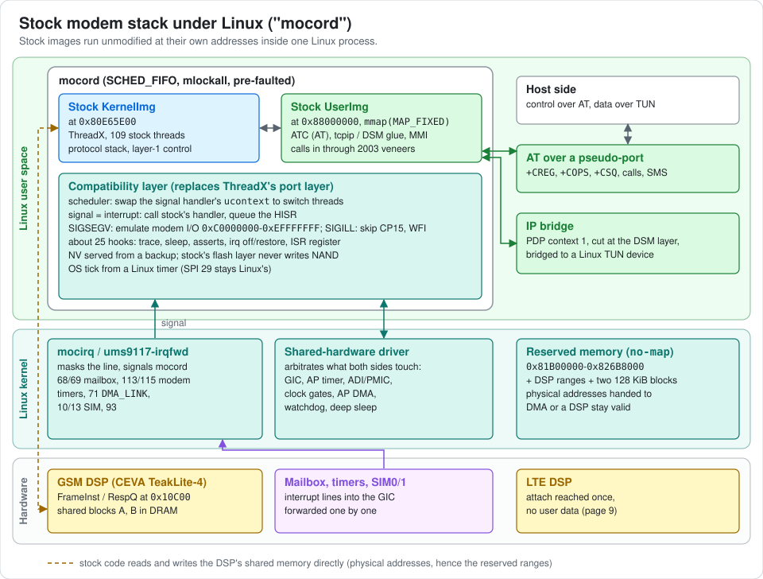

# itel IT9220 / Unisoc UMS9117: hardware and firmware reference

A reusable reference for the **itel IT9220** (marketed as *Neo X10+ 4G*), a bar
feature phone built on the **Unisoc UMS9117** SoC (T117 / SC6531E class, one
ARM Cortex-A7, 64 MB RAM, SPI NAND). It is written for other people who want to
flash it, reverse-engineer its stock firmware, or put their own software on it.

It is distilled from a long reverse-engineering effort on one unit. The facts
come from the stock firmware (BOOT0/BOOT1/FDL, the MOCOR kernel and user
images, the DSP and Wi-Fi/BT images) and from experiments on a real phone.
Everything is tagged with how well it is known.

## At a glance







More diagrams in the chapters: [memory map](src/img/memory-map.svg), [SPI NAND layout](src/img/nand-layout.svg),
[GSM DSP queues and mailbox](src/img/gsm-dsp-flow.svg). They are generated by
`src/img/make_diagrams.py` (standard-library Python); edit the data there and re-run it.

**Photos welcome.** There are no photos of the board or the phone here yet. If you
have one of these phones open, pictures of the board (both sides, test points, the
UART pads if you find them) would be a great contribution. Please remove the IMEI
label and serial numbers from any photo first.

## Proof levels

| Tag | Meaning |
|---|---|
| **Proven (hardware)** | Observed on a real phone. |
| **Proven (emulation)** | The stock code was run in an emulator (Unicorn) and the behaviour read from the trace. Not yet seen on silicon. |
| **Read** | Read from disassembly or decompilation of the stock images. The code path is real; the interpretation may be off. |
| **Inferred** | A reasoned guess from names, structure or other chips of the family. |
| **Unknown** | Not determined. |

Where a section has no tag, it is a plain fact from the firmware (a partition
table, a register address, a string).

Addresses are for one specific stock build (kernel dated 2024-08-15; a later
2024-09 firmware package differs). **Every code address in these pages is
build-specific.** Hardware register addresses (SoC blocks) are not.

## Contents

| Page | What |
|---|---|
| [1. Device and SoC](src/01-device.md) | Identity, memory map, register blocks, interrupt lines. |
| [2. Boot chain and partitions](src/02-boot-and-partitions.md) | BOOT0/BOOT1/KernelImg/UserImg, the DHTB container, NAND layout, NV. |
| [3. Download mode, flashing, recovery](src/03-flashing-and-recovery.md) | USB IDs, boot key, tools, a safe UserImg-only workflow, restore procedure, Linux-side NAND writes. |
| [4. On-board peripherals](src/04-peripherals.md) | PMIC/ADI, RTC, battery, LCD (ST7789 over SPI), keypad, SD/MMC, USB device, LEDs, vibrator, torch, headset, camera. |
| [5. Audio](src/05-audio.md) | VBC, AP DMA and the PMIC codec: playback, capture, headphone, FM audio. |
| [6. Wi-Fi, Bluetooth and FM (Marlin2)](src/06-wcn-marlin2.md) | The WCN chip on SDIO1: power-up, firmware load, packet protocol. |
| [7. The stock MOCOR OS](src/07-mocor-stock-os.md) | ThreadX, KernelImg/UserImg veneers, start-up, patching rules. |
| [8. The GSM DSP](src/08-gsm-dsp.md) | Loading, queues, mailbox, what is decoded and what is not. |
| [9. LTE findings](src/09-lte.md) | LTE DSP bring-up, attach under a foreign host, blockers. |
| [10. Running the stock modem stack under Linux](src/10-modem-under-linux.md) | The "mocord" approach: write-up and honest status. |

## Companion repositories

- <https://github.com/maxmaster55/ums9117-linux>: Linux (6.12) bring-up for this phone: drivers, device tree and loader.
- <https://github.com/maxmaster55/unisoc-pac-tools>: tools for Unisoc `.pac` firmware packages.

## Safety first

The single rule that keeps the phone recoverable: **never write BOOT0, BOOT1 or
KernelImg**. A UserImg-only workflow stays recoverable with the hold-key USB
path described in [page 3](src/03-flashing-and-recovery.md). Back up NV (it holds
the radio calibration and the IMEI) before any write.

## What is deliberately not here

No firmware bytes, no disassembly listings, no calibration or identity data.
Only addresses, register facts, structure and descriptions. Bring your own
firmware dump (from your own phone or the vendor package).

## Building this book

The pages are an [mdBook](https://rust-lang.github.io/mdBook/):

```sh
cargo install mdbook      # or use a release binary
mdbook serve              # live preview
mdbook build              # output in book/
```

A GitHub Pages workflow (`.github/workflows/pages.yml`) publishes it.

## License

Documentation: [CC-BY-4.0](LICENSE). Any small code or shell snippets in these
pages are additionally available under MIT OR Apache-2.0, matching the
companion repositories. This is an independent research project; it is not
affiliated with itel, Transsion or Unisoc. Names are used only to identify
hardware.
