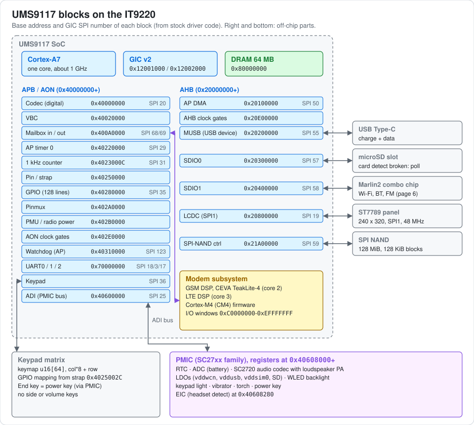

# 4. On-board peripherals

Register facts come from stock driver code (KernelImg), cross-checked against
mainline Linux drivers for the same IP where one exists. Tags as in the
[index](README.md).



## ADI and the PMIC

The PMIC (an SC27xx-family part; the audio codec inside is the "SC2720" block) is on
the **ADI** serial bus at `0x40600000`, and its registers appear at
`0x40608000 + <Linux sc27xx offset>`.

| Register | Address |
|---|---|
| ADI target address | `0x40600028` |
| ADI data / read result | `0x4060002C` (negative read = error/not ready) |
| ADI status | `0x40600030`, bit `0x800` = busy |

Access protocol (BOOT0, FDL1): write the address, poll data until non-negative
(with a timeout), wait for status not busy, then access. **Raw ADI reads that do
not wait correctly froze the phone** when the radio stack was also running; give
the bus one owner. Exact PMIC part number is **Unknown** (mainline's sc2730/sc2731
MFD does not list it; the RTC offsets match `rtc-sc27xx`).

Notable PMIC registers:

| What | Address / bits |
|---|---|
| Module enable | `0x40608C08` (bit `0x200` analog, `0x10` audio) |
| Clock enables | `0x40608C0C`, `0x40608C10` (`0x80`, `0x1000`, bit 3 EIC) |
| Reset mode (BOOT1 reads it) | `0x40608E24` bits [8:4]; `0x17` = auto-download |
| Charger/cable present | `0x40608E14` bit 3 (`ANA_CHGR_STATUS`); bits [7:5] used by the listener |
| Power key bit | `0x40608034` bit 4 |
| Power off | `0x40608C20` bit 0 set (stock `POWER_PowerOff` tail) |
| Restart | PMIC watchdog (0.5 s timeout) |
| LDO `vddwcn` (id 27) | on = clear bit 0 of `0x40608CAC`; voltage low 6 bits of `0x40608CB0`, 800 mV + 12.5 mV/step |
| LDO `vddusb` (id 11) | `0x40608D30` bit 0 (set = off) |
| SD power | clear bit 0 of `0x40608D00` and `0x40608D0C` |
| SIM LDO `vddsim0` (id 7) | switched 1.8 V / 3.0 V by the SIM driver |
| EIC (headset detect) | base `0x40608280` (sc27xx-eic layout) |

## RTC

Counters at `0x40608200` (sec), `04` (min), `08` (hour), `0C` (day); update
registers `0x40608210/14/18/1C`; interrupt raw/clear `0x40608234/38` (bits 8..11 =
update done). Read twice and compare. **The day-counter epoch is not proven**: the
stock date check works from 1980, Linux's driver from 1970. A workable approach:
try 1980, 1970, 2000 and take the epoch that yields a year in a 10-year window
(candidates are at least 10 years apart), then keep writing in that epoch.
The RTC resets to its default after a full PMIC power-off.

## Battery and charger

ADC: CTL `0x40608404`, CH_CFG `0x40608408` (channel 5 = VBAT, scale 3 in bits 10:9),
DATA `0x40608450`, INT_CLR `0x40608458`, INT_RAW `0x40608460`. Stock read routine
`0x81042AE6`. Calibration: PMIC efuse block `0x12`: raw at 4200 mV = (b0+728)*4,
at 3600 mV = (b1+605)*4. Take the median of three conversions and smooth; map to
percent with a generic Li-ion curve; treat readings outside 2800..4600 mV as unreadable.
**Unknown/untuned:** the ADC scale table stock uses; if the percentage is off, those
and the CTL mode bits are the first suspects. Charger present: `0x40608E14` bit 3.

## LEDs, vibrator, torch

All PMIC current drivers, reached over ADI (stock `analog_phy.c`):

| Function | Register | Notes |
|---|---|---|
| Init | `0x40608C08` OR `0x200`, `0x40608C10` OR `0x80` and OR `0x1000` | |
| Keypad light | `0x40608DF8 = (reg & 0x0FFF) OR (level << 12)`, then clear bit 11 | off = set bit 11; level 1..15 |
| Vibrator | `0x40608E00` OR level (1..7), then clear bits 8 and 9 | off = set bits 8 and 9; level 1 about 2.9 V, 7 about 3.5 V |
| Torch / flash LED | bit 15 of `0x40608DF4` | stock `GPIO_SetTorch` -> analog device 5; "logical GPIO 9" is a product-table callback, **not** physical GPIO 9 |
| LCD backlight | PMIC WLED at `0x40608180` | stock analog device 0 |

The product GPIO table (`0x8194C510`, 16-byte records `{id, type, valid level,
number, callback}`) maps logical functions to either a GPIO, a PMIC EIC line, or just a
callback. Type 4 = callback only.

## LCD

ST7789 on **SPI1**, 48 MHz, `--spi_mode 1`, driven through the LCDC at `0x20800000`
(registers `0x20800110..0x2080011C` seen in stock; driver file
`lcdc_drv_ums9117.c`, `lcd_if_spi.c`). 240 x 320. A working minimal driver does:
panel reset (always), SPI1 init, the ST7789 init sequence, LCDC set-up; each frame:
copy to a 32-byte aligned DMA buffer, re-send `RAMWR`, clean the D-cache range, start
the LCDC, and wait (bounded) for the previous one. A whole 150 KB frame pushed in one
piece takes about 26 ms; a push that times out costs about 150 ms. Stock's driver
leaves the panel in its own settings, so a replacement must re-run its own init. The
panel's backlight is the PMIC WLED. The precise panel init sequence lives in
stock `lcd_if_spi.c` and is not reproduced here.

## Keypad

Matrix keypad driven by `kpd_phy.c`; the key-to-GPIO mapping is **read from the
strap register `0x4025002C`**, not hard-coded:

```c
case 1: return ((R(0x4025002C) & 0x70) >> 4) | (8 * (R(0x4025002C) & 7));
case 2: return ((R(0x4025002C) & 0x7000) >> 12) | (8 * ((R(0x4025002C) & 0x700) >> 8));
```

The keymap is a `u16[64]` table in KernelImg indexed `col*8 + row` (file offset
`0xAEB940`, VA `0x81951740` in the examined build). The code at row 0, column 0 is
`0x08` (left soft key) on this phone. The red End key doubles as the **power key**,
read from the PMIC (power-key bit above) rather than the matrix; a driver typically polls
it over ADI every ~20 ms, and each failed ADI read can spin several ms, which is
visible as hitching on a single-core system. There are no side/volume keys.

## SD / MMC (SDIO0)

microSD host at `0x20300000`, SPI 57; the Spreadtrum "R11" SDHCI layout (mainline
`sdhci-sprd`, `sprd,sdhci-r11`, handles it with `fixed-clock` nodes). Set-up stock
performs before use (repeat if the card does not answer):

1. AHB enable: `0x20E01000 = 0x80` and reset.
2. Pins: `0x402A0120..` = 0, `0x402A0520..` = `0x100080`, last one `0x180000`
   (`0x402A0520..0x402A0534`).
3. SD power over ADI (clear bit 0 of `0x40608D00` and `0x40608D0C`).
4. Base clock select `0x2150006C` low 3 bits = 1 (26 MHz). Actual SD clock = base / (2 * div):
   about 203 kHz (init), 13 MHz, 26 MHz.

Quirks: card detect is broken (poll); DMA buffers must be 512-aligned and must not
cross a 4 KiB SDMA boundary, and the data cache lines must be dropped again after a
transfer (the A7 can refill them speculatively); use the longest data timeout
(the R11 counts SD clocks, 8 was about 80 ms at 26 MHz); GPT-partitioned cards need
64-bit LBA support in any FAT stack (a protective MBR otherwise looks like
"no supported filesystem"). Fallback if a card will not mount: 12 MHz without
high-speed, then 1-bit bus. The second host, SDIO1 (`0x20400000`, SPI 58, clock
select `0x21500074`, gate bit 8, reset `0x20E00004` bit 12), is wired to the Wi-Fi/BT
chip ([page 6](06-wcn-marlin2.md)).

## USB device (MUSB)

Mentor core at `0x20200000`, SPI 55. Stock bring-up (**Read**) in order:
AHB_EB bit 4 (`0x20E01000 = 0x10`, wait 10), reset bits 4..6 (`0x20E01004 = 0x70`,
wait, `0x20E02004 = 0x70`), `0x402E10B0 = 0x800`, `0x40431024 = 0x200`,
`0x40431018 = 0x08000000`, `0x20E03024 |= 0x01400000`, `0x20E03028 |= 0x60000000`,
`0x20E03030 = 0x17C0`, PHY out of power-down (`0x402E2024 = 0x30000`,
`0x403E2010 = 1`), `vddusb` off, wait, on, then `POWER = 0x60`, `INTRUSBE = 0xF7`,
`INTRTXE = 1`. FIFO size 512 (`TXFIFOSZ = 6`), TX at `n*1024`, RX at `n*1024+512`,
flat endpoint registers `0x100 + 16n`. Stock moves bulk data with Unisoc's own DMA
(`0x20201BE0 + channel*32`) and uses the FIFO by hand only on EP0.

**Known hazard:** reading DEVCTL with the clock gate off crashed early test images;
check AHB_EB first and never touch a MUSB register with the clock off. A mainline
`musb` glue driver with PIO-only bulk endpoints and the `g_cdc` gadget (serial +
CDC-ECM) is a workable debug link; the *PC-visible* behaviour is **not hardware-proven
in these notes**. The cable bit (`0x40608E14` bit 3) tells you a PC/charger is present.

## Headset jack

Stock product GPIO ids: `0x11` = detect, `0x12` = button. Both are type 3 = **PMIC EIC**:
jack = EIC 12, button = EIC 3, both active high (EIC base `0x40608280`, layout of
sc27xx-eic: data +0x00, mask +0x04, IEV +0x14, IE +0x18, MIS +0x20, IC +0x24, TRIG
+0x28, debounce +0x40+4n; enable via `0x40608C08` and `0x40608C10` bit 3). Stock
also measures 3- vs 4-pole with the ADC and the codec's head-detect block
(`ANA +0x34..0x3C`); not reproduced. A 150 ms poll of EIC data (debounced twice) is a
workable detector; a button held more than 5 s is a 3-pole plug with that contact tied.
**Not run on a phone** in these notes.

## Camera

Stock has a DCAM/ISP stack and five sensor drivers probed in turn: **BF30A2, BF3903,
GC0310, GC032A, GC6133** (VGA/QVGA class). Which one is fitted is **Unknown**. A
minimal capture needs: sensor power (PMIC CAMA/CAMD/CAMIO LDOs and PWDN/RESET GPIOs, not
mapped), MCLK from the camera clock, I2C/SCCB to read the chip id, then the
DCAM/CCIR interface into memory. Not started.

## Other hardware

No notification LED, no proximity/light/motion sensors (no driver strings in stock).
GNSS is a separate modem image with its own loader (`GPS_FDL`).
