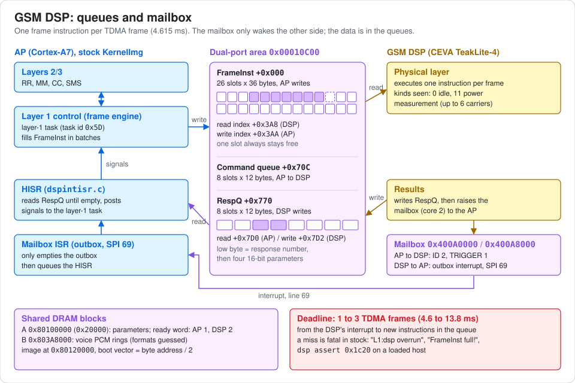

# 8. The GSM DSP

The GSM physical layer runs on a **CEVA TeakLite-4** DSP. Layers 2 and 3 and the layer-1
*control* (frame engine) are AP code in the stock kernel. This page records how the AP loads
and starts the DSP and talks to it. Status first:

| Finding | State |
|---|---|
| Firmware load address and size | **Proven (emulation)**; load/start **Proven (hardware)** |
| Reset, boot vector, boot enable | **Proven (hardware)** |
| "DSP is ready" handshake | **Proven (hardware)**: ready word 2 within 1 ms |
| Mailbox registers, core number, interrupts | **Proven (emulation)**, both directions seen on hardware |
| FrameInst and RespQ queues | **Proven (emulation)**; indices sane on hardware |
| Dual-port area at physical `0x10C00` | **Proven (hardware)** |
| Frame instruction header, idle, power measurement | **Proven (emulation)** for the named fields |
| Response numbers 0..0x26 | handler addresses known, meanings **not decoded** |
| Cell search, BCCH, RACH, SDCCH, TCH frame instructions | located, **not decoded** by this effort (stock layer 1 was *run* instead, see [page 10](10-modem-under-linux.md)) |
| Speech buffers and rings | located, formats **guessed** |
| Clock/power-domain set-up from cold | not traced; stock boot has already done it |

```
        AP (Cortex-A7)                         GSM DSP (CEVA TeakLite-4)
  layer 2/3  RR MM CC SMS
  layer 1 control (frame engine)
        |   FrameInst queue  26 x 36 bytes  ------------>  executes one per frame
        |   RespQ             8 x 12 bytes  <------------  results, "ask more"
        |   shared blocks A and B (parameters, received blocks, voice PCM)
        |   mailbox core 2: interrupt each way
        v
  AON APB: reset, boot vector, boot enable
```

The image (`GSMDSPCODE`, 3.2 MB) begins with the text `V1GGE_Bugid__...` and `versionTD1.0001`; offset
`0x138728` holds a CEVA profiler version string. Code starts at file offset `0x80`; data runs to `0x285FF8`.
The DSP counts **16-bit words**: stock writes *byte address / 2* into the boot vector register.

## Loading

Stock's init (`0x80F4E04E`) reads three partitions whole from sector 0, no header parsing:

| Partition | Goes to | Bytes |
|---|---|---|
| CM4 code | `0x80020000` | `0xD4000` |
| GSM DSP code | `0x80120000` | `0x300000` |
| LTE DSP code | `0x80468000` | `0x49E000` |

So file offset *x* of the GSM image is at `0x80120000 + x`. A failed read ends in "Please download g_dsp image again".

## Memory

```
0x00010C00  dual-port area (chip internal RAM)   GSM: 0x1000 bytes
0x80100000  shared block A                       0x20000
0x80120000  gsmdsp image                         header 0x00, code 0x80 ...
0x803A8000  shared block B                       voice rings and more
0x80420000  end of the GSM DSP's 3 MB + 128 KB
0x80468000  ltedsp image
```

Pointer table built by `0x81476494` (`sharedmem_proc.c`) at `0x81C3BFA8`: +0x24 block A `0x80100000`, +0x28 dual-port
`0x00010C00`, +0x2C `0x8011C000` (DSP parameter tables, NV copies), +0x30 `0x8011EC90`, +0x18/+0x1C/+0x20
`0x8011F300`/`0x8011FFFE`/`0x8010D400`, +0x34 block B `0x803A8000`. Parameter block `0x80119670` (`0x6F8` bytes): ready word
at +0 (AP writes 1, DSP answers 2); "DSP run" word `0x80119CA4` (u16, DSP sets non-zero when it runs); RF open/close
times at +1904/+1906 (DSP writes them; stock asserts both non-zero).

## Starting the DSP

AON APB block `0x402E0000`:

| Function | Register | Does |
|---|---|---|
| `0x815B9004(on)` | `+0x130` bit 17 | GSM DSP reset (1 = held) |
| `0x815B9072(on)` | `+0x254` bit 0 | GSM DSP boot enable |
| `0x815B9062(v)` | `+0x250` | GSM DSP boot vector (DSP words) |
| `0x815B90D8(1)` | `+0x6C` | OR `0x9620` (meaning unknown) |
| LTE equivalents | `+0x130` bit 16, `+0x24C`, `+0x248` | |

Cold start (`layer1_dsp_download.c`, `0x8119941E`):

```
0x402E0130 |= 0x20000        hold reset
0x402E0254 &= ~1             boot enable off
0x402E0130 |= 0x20000        (again)
0x402E006C |= 0x9620
0x402E0250  = 0x40090040     (0x80100000 + 0x20080) >> 1 = image offset 0x80
            (100 empty loops)
0x402E0254 |= 1              boot enable on
0x402E0130 &= ~0x20000       release
```

Restart (`0x80F3F8A8`) is the same without the second reset write and the `+0x6C` write; before it the AP writes **1**
into the ready word and `0x80F3F828` polls it every ms (up to 200 times) until the DSP writes **2**. A mode word
(`0x81C277AC`, values 0..2) selects one of two restarts: mode 0 uses ready word `0x801B8000` and vector `0x40090040`
(the one that works); mode 1 uses `0x80120044` and vector `0x401DD800` (byte address `0x803BB000`, zero in the file;
not understood). `0x80F3F6B8` prepares shared memory before first start (zero both ready words, write `0xBB` to
`0x80120048`, zero `0x6F8` bytes at `0x80119670`, and fill a few words from NV/board options; those values are **unknown**).

**Two start conditions that matter on hardware.** The DSP must be started with the ready word cleared to 0; and stock's
radio power-on must have run (`DRV_WTLCP_Is_PowerOn_Ready` `0x8106408C` waits for PMU `0x402B00C4` bits 4:0 = 0 and
`0x402B00D4` bits 7:4 = 6). A host that starts the DSP and then does not serve the mailbox freezes the whole phone a few
milliseconds later.

## Mailbox

`mbox_phy.c`. Registers: ID 0, MSG_LO 4, MSG_HI 8, TRIGGER `0xC`, FIFO_RST `0x10`, FIFO_STS `0x14`, IRQ_STS `0x18`,
IRQ_MSK `0x1C`, FIFO_DEPTH `0x24`.

| Step | Stock | Writes |
|---|---|---|
| Set-up | `0x815252C2` | `0x402E1004 = 0x200000` (mailbox clock), outbox FIFO_RST 0, inbox mask `0xFFFFFFFC`, outbox mask `0xFFFFFFFE` |
| Interrupts | | inbox SPI 68 -> `0x81525024`; outbox SPI 69 -> `0x81525194` |
| Handler for the GSM DSP | `0x811ECF80` -> `0x812BA378(2, 0, isr, hisr)` | core **2**; ISR `0x8117F9A5`, HISR `0x8117F9F7` (`dspintisr.c`); the LTE DSP is core 3 |
| Interrupt the DSP | `0x811ECF64` -> `0x81525342` | MSG_LO 0, MSG_HI 0, ID 2, TRIGGER 1 |
| Outbox IRQ | `0x81525194` | per message read MSG_LO/MSG_HI, ID & 7, TRIGGER 1; IRQ_STS = (status & 0xFF00) OR 1 |

The message content is always zero: the mailbox only wakes the other side; the data is in the queues.
**Stock's mailbox HAL init `0x812BA320` is called only from the full boot function `0x80F4E31C`.** Any host that does not
run that function must replicate it (a few global words), or the core-2 dispatcher has no DSP pointers and the l1_init
handlers are never serviced even though line 69 fires.

## Queues (dual-port area, offsets from `0x10C00`)




| Offset | What | Writer |
|---|---|---|
| `0x000` | **FrameInst**: 26 slots x 36 bytes | AP |
| `0x3A8` / `0x3AA` | FrameInst read index (DSP) / write index (AP) | |
| `0x3AC` | four blocks of `0xAC` (TX buffers, guess) | |
| `0x70C` | AP->DSP command queue: 8 slots x 12 bytes | AP |
| `0x76C` / `0x76E` | its read (DSP) / write (AP) index | |
| `0x770` | **RespQ**: 8 slots x 12 bytes (32-bit word whose low byte is the response number, four 16-bit parameters) | DSP |
| `0x7D0` / `0x7D2` | RespQ read (AP) / write (DSP) index | |
| `0xD58` / `0xD5A` | another queue, not decoded | |

Index rule: slot = (write index + 1) mod N is filled, then the index moves, so one slot stays free (25 frames = 115 ms fit in
FrameInst). Words both sides write are read until two reads agree (`0x8147631E`) and written until they read back
(`0x81483830`). A full queue asserts "FrameInst full!". A second response queue (10 x 12 bytes, in block B at `+0x1D14/+0x1D18`)
and an audio command queue exist.

### Frame instructions

The stock design is not "command, then indication". The AP's own layer 1 writes one **frame instruction for every TDMA
frame** (4.615 ms) and the DSP executes it. 107 places write them. `frameinstrutil.c` `0x8148B400` starts each: 36 zero bytes,
then `0xFF` in bytes `0x0E..0x1D`.

| Word (offset) | Bits | Meaning |
|---|---|---|
| 0 (0x00) | 4:0 | kind ("rf_op", below 32) |
| 0 | 15:9 | "ask more" mark: `0x41` (`0x8200`) or `0x42` (`0x8400`) |
| 1, 2 | | frame number (high 7 bits, low 16), modulo `0x297000` (the GSM hyperframe) |
| 7..11 (0x0E..0x16) | 9:0, 15:10 | kind 11: carrier (ARFCN index) and gain index for a power measurement; unused = `0xFFFF` |
| 17 (0x22) | 2, 3, 5, 6, 14 | flags |

Kinds seen: **0 = idle frame**, **11 = power measurement** of up to six carriers. Emulated example: three carriers at frame `0x12345`.
The other kinds are in the remaining callers of the writer (`0x8148B4EA..0x8149441C` about 70, `0x80FE8E58..0x80FED7A4` 12,
`0x80ED502C..0x80EF367E` 3); strings name `AGCH_CHAN_RXTAG`, `BCCH_CHAN_RXTAG`, `PCH_CHAN_RXTAG`, `SDCCHTCH`, "wrong dch type for
CBCH". None decoded.

### Responses

`dspintisr.c` `0x8117F9F6` reads RespQ until empty and switches on the number (table `0x8117FA44`, 39 entries). Most cases pack
the four parameters into a signal for the layer-1 task (task id `0x5D`). Response 4's parameter 1 is a per-frame status bit mask
(bit 1..5 -> signals `0x398..0x39C`; bit 0 calls `0x814A60D4`); response 6 ends in an assert (a DSP fault report). Meanings of
the others are not decoded. After the stock GSM `l1_init` (`0x814A678E`) with the layer-1 control run, two responses of types
`0x4D` and `0x72` arrive.

### Speech

The DSP runs the speech codec. PCM crosses in shared block B: `sharedmem_proc.c` `0x8147C31C` copies up to 320 words
("vocie count is too great") into one of 7 buffers of `0x500` bytes at `+0x45B4` (write index `+0x1D9E`); further rings at
`+0x2CB4` and `+0x36B4`, indices `+0x1D9C..+0x1DA6`. AP side: `layer1_audio.c`, `voice_process.c`. From there samples go through
the VBC and the PMIC codec ([page 5](05-audio.md)). Ring directions, rates and the commands that open the voice path are guesses
until read from code or seen; in practice stock's own voice open (`!call:0x8174EA48` at alerting, in one host experiment) was used.

## Real time

| Question | Answer |
|---|---|
| Who does per-frame work in stock? | A normal RTOS task. The mailbox ISR only empties the outbox; `dspintisr.c` reads RespQ and posts signals; the layer-1 task plots. |
| How far ahead is the queue filled? | In batches; the AP marks an earlier instruction "ask more" (3 before the end when 5 or more pending, 2 when 4, 1 when 2-3). |
| Deadline | **1 to 3 TDMA frames: 4.6 to 13.8 ms** from the DSP's interrupt to new instructions being in the queue. |
| On a miss | fatal in stock: "L1:dsp overrun %d, %d ms", "over run!distance", "FrameInst full!". The assert `dsp assert 0x1c20` (`dspintisr.c:0x24b`) is the recurring symptom on a loaded host. |
| Work per frame | plot one measurement frame: 214 instructions; idle frame 158; read one response 84; outbox interrupt with a message 131; interrupt the DSP 97. |

The cost is being on time, not the work. A host needs: a preemptible kernel with real-time scheduling and locked memory,
no long non-preemptible sections (a 150 KB LCD push over SPI is about 26 ms if sent in one piece), and no first-touch page
faults on stock code read from a slow medium (3-12 ms stalls were measured). PREEMPT_RT is not selectable on ARMv7 in plain
mainline 6.12; it needs the out-of-tree RT patch set.

## Own-stack route (not done)

Writing a new layer-1 control for this DSP (the part OsmocomBB gets from its own Calypso firmware), a SIM driver, the voice
path, and running OsmocomBB's `mobile` on top was estimated at three to six months and **was not done**; instead stock's own
layer 1 was run ([page 10](10-modem-under-linux.md)). The CEVA code cannot be emulated, so every decoded message needs a phone.

## Related work

Other UMS9117 efforts: `lovelytingy/Nokia-2660-Emulator` (Rust/Unicorn, boots to the UI stages, nothing on the modem);
`openfeaturephone/f286-bringup` and `ruio-f286` (Linux on the same chip family; its LTE DSP reports ready but releasing it
hangs the AP about 1.1 s later, which argues for running stock's own init); OsmocomBB (Calypso). A damaged vendor PAC
(ECC-corrupted firmware) has been reported in the wild: verify checksums.
